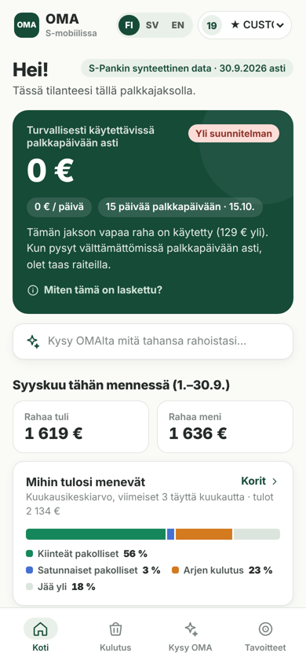
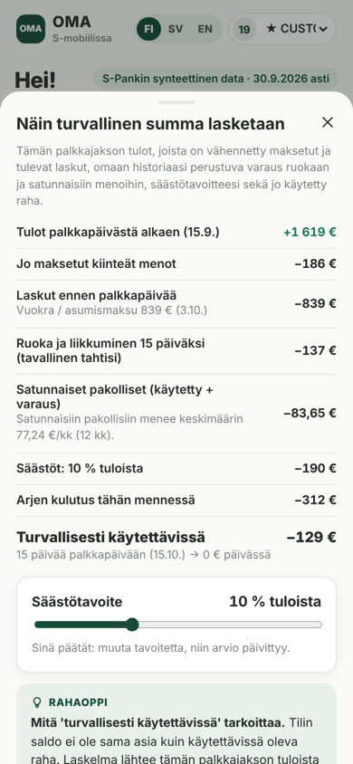
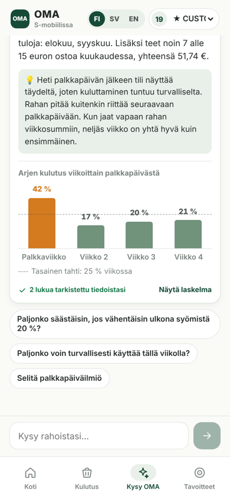
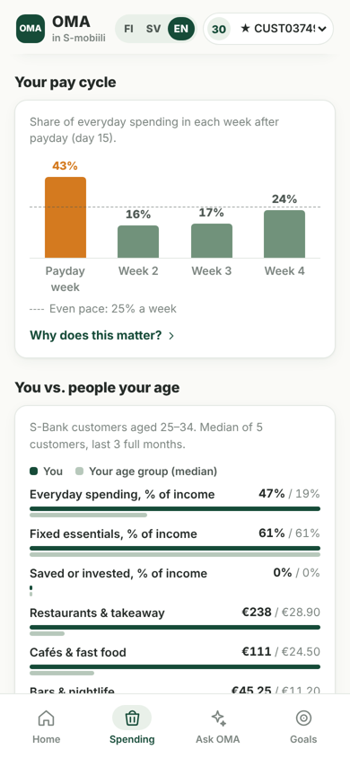
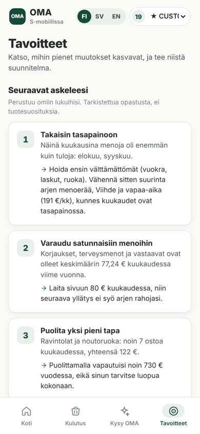
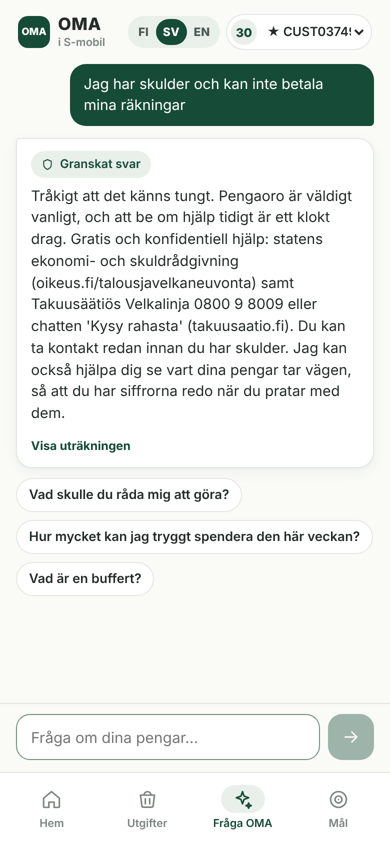

# OMA: Your money. Your understanding.

**An AI financial coach for S-mobiili.** Built at **Junction 2026** for the **S-Pankki** challenge.

**🔗 Live demo:** https://oma-4qvl.onrender.com/ 
**🎥 Video:** *add your video link here*

> Your bank tells you where your money went. OMA helps you understand what it means, and what you can do next.

Customers chat with their own transaction data in **Finnish (default), Swedish or English**. OMA sorts every euro into the challenge's **three baskets**, explains a **safe-to-spend** amount step by step, simulates **what-if** savings, compares you with **S-Bank customers your age**, and gives only **vetted advice based on your own numbers**. Every figure comes from a deterministic engine, never from the AI.

*The live demo runs on the free tier: the first visit can take about 50 seconds while the server wakes up.*

---

## Screenshots

| Home: safe to spend | How it's calculated | Ask OMA |
|---|---|---|
|  |  |  |
| **Pay cycle & people your age** | **Vetted next steps** | **Safety guard (Swedish)** |
|  |  |  |

---

## The problem

People can see their balance and transactions, but not what they mean: why money runs out before payday, which habits cost the most, or how much is actually safe to spend. Bank apps show data; OMA explains it, the way a friend who's good with money would.

## What OMA does

| | |
|---|---|
| 🧺 **Three baskets** | Every expense is sorted into *fixed essentials* (rent, bills, groceries), *occasional essentials* (dentist, repairs) or *everyday spending* (cafés, takeaway, taxis). When OMA isn't sure (e.g. a €500 electronics purchase: broken fridge or new TV?), it asks instead of guessing. |
| 💶 **Safe to spend** | A pay-cycle budget, not a balance: income since payday − bills still due − food & commuting until payday − irregular-cost reserve − savings target − spending so far. Every step is shown, the savings target is adjustable, and the result is capped by the real account balance. |
| 💬 **Ask OMA** | Natural questions in FI/SV/EN: *"Why am I running out of money before payday?"*, *"How much could I save if I ate out 20% less?"*, *"Can I afford €100 this weekend?"* Answers come with charts and a **Show the math** panel. |
| 📅 **Pay-cycle insight** | Shows how much of your everyday spending happens in the week after payday, the classic reason money runs out. |
| 👥 **You vs. people your age** | Medians from S-Bank's own 5,100 customers by age group, plus Statistics Finland household survey data. |
| 🎯 **Goals & what-if** | Slide to cut a habit by X%, see the monthly, yearly and 5-year effect, and turn it into a goal with a target date. |
| 🧭 **Vetted next steps** | Start a buffer, use a weekly allowance, reserve for irregular costs, halve one habit… each triggered by the customer's real numbers. |
| 🔎 **Explore your data** | In the MyData spirit: slice your own spending by category, merchant, weekday or month, as a chart or a table. |

## How OMA avoids hallucinations and bad advice

1. **Topic guards run before any AI.** Investment, loan/credit, debt-trouble and tax questions get a reviewed answer, never a product recommendation. Debt worries point to free help: the state's *talous- ja velkaneuvonta* and Takuusäätiö's *Velkalinja* (0800 9 8009).
2. **The AI never does arithmetic.** It can only call **16 engine tools**. The engine computes; the AI explains in plain language.
3. **Advice only from a vetted catalogue**, triggered by real data. Essentials (rent, food, medicine, childcare) are never targeted for cuts.
4. **Every € figure is verified** against tool results. If one is unverified, the AI rewrites once; if it still fails, the rule engine answers instead. The UI shows "✓ 3 figures checked against your data".
5. **Works offline.** Without an API key or network, a multilingual rule engine answers the core questions, so the demo never breaks.

## Architecture

```
S-Pankki transactions ──► Financial engine (pandas) ──► AI coach (tool calls only) ──► Mobile web app
 MCC · type · balance      every number + vetted advice     explains, never calculates      FI / SV / EN
```

- **Backend:** Python, FastAPI, pandas. Deterministic engine, MCC-based classification, age-group benchmarks
- **AI:** Anthropic or any OpenAI-compatible model via tool calling, with a grounding check and an offline fallback
- **Frontend:** React (Vite), mobile-first, hand-built SVG charts, S-Bank green palette, WebView-ready for S-mobiili

## The data

Built on the **S-Pankki Junction 2026 synthetic dataset**: 3.6M transactions, 5,100 customers, Oct 2024 – Sep 2026.

- **No merchant names**, so categories come from the **transaction type** (rent, utilities, salary, investments), the **MCC code** (5411 grocery, 5814 café/fast food, 4121 taxi…) and the bank category.
- **`salary_sweep`** (salary moved to another own account) is excluded from spending and saving. **`investment_deposit`** counts as saving.
- **`balance_after_eur`** caps safe-to-spend, so OMA never suggests money that isn't there.
- **Age-group medians** are computed from all customers and stored in `data/peers.json`.

The repo includes a **sample of 40 real customers** from the dataset (`data/sbank_sample/`), so it runs out of the box. Put the full dataset next to this folder (`../Junction-2026-S-pankki/`) or set `OMA_DATA`, and OMA uses it automatically.

## Run locally

```bash
cd backend
pip install -r requirements.txt
python -m uvicorn app:app --host 0.0.0.0 --port 8000
```

Open http://localhost:8000 (Windows: just run `start.bat`). The built web app is included in `frontend/dist`; Node.js is only needed to change the frontend.

**Optional AI:** set `ANTHROPIC_API_KEY` (or `OPENAI_API_KEY` + `OPENAI_BASE_URL`). Without one, the offline rule engine answers.

**Try these customers:** `?customer=CUST01365` (19, runs out before payday) · `CUST01546` (18, on track) · `CUST03749` (30, 47% of income on everyday spending)

## Deployment

The live demo runs on **Render** (free tier), deployed from this repo with `render.yaml`:

- **Build:** `pip install -r backend/requirements.txt`. **Start:** `cd backend && uvicorn app:app --host 0.0.0.0 --port $PORT`
- **Data:** the hosted version uses the bundled 40-customer sample, because the full 346 MB dataset can't be hosted on GitHub. Age-group benchmarks still come from all 5,100 customers via `data/peers.json`, generated locally from the full dataset.
- **AI:** add `ANTHROPIC_API_KEY` under *Environment* in Render to enable the language model. Without it, the multilingual rule engine answers.
- **Cold start:** the free instance sleeps after 15 minutes of inactivity, so the first request can take about 50 seconds.

To deploy your own copy: fork this repo, then in Render choose **New → Blueprint** and select the fork.

## How it maps to the judging criteria

| Criterion | OMA |
|---|---|
| **Financial literacy** | Three baskets everywhere, pay-cycle chart, 💡 lesson in answers, 10 team-written lessons, spender profile, vetted next steps, benchmarks |
| **Originality of AI integration** | AI as interpreter over a deterministic engine; figure-level grounding check with retry and fallback; topic guards; Show the math |
| **Mobile UX** | 4 tabs (Home, Spending, Ask OMA, Goals), hero number first, one-handed at 390px |
| **Feasibility** | Runs on the full dataset on a laptop; plain-Python rules; no new bank integration needed |
| **S-mobiili integration** | Finnish-first and bilingual like S-mobiili, WebView-ready, peer benchmarks from S-Bank's own customers; PSD2 data from other banks fits the same engine |

## Project structure

```
backend/
  app.py       API + serves the web app
  engine.py    all calculations and vetted advice
  coach.py     AI tool loop, grounding check, guards, offline router
  rules.py     MCC / transaction type → basket
  sbank.py     dataset loader + Parquet cache
  peers.py     age-group benchmarks
  i18n.py      FI / SV / EN text, MCC labels, help resources
  lessons.py   money lessons (FI / SV / EN)
frontend/src   React app (Home, Spending, Ask OMA, Goals)
data/          bundled sample, peers.json, featured demo customers
DEMO.md        3-minute demo script
```

---

*OMA is a hackathon prototype on synthetic data. It gives guidance, not investment, loan or tax advice.*
